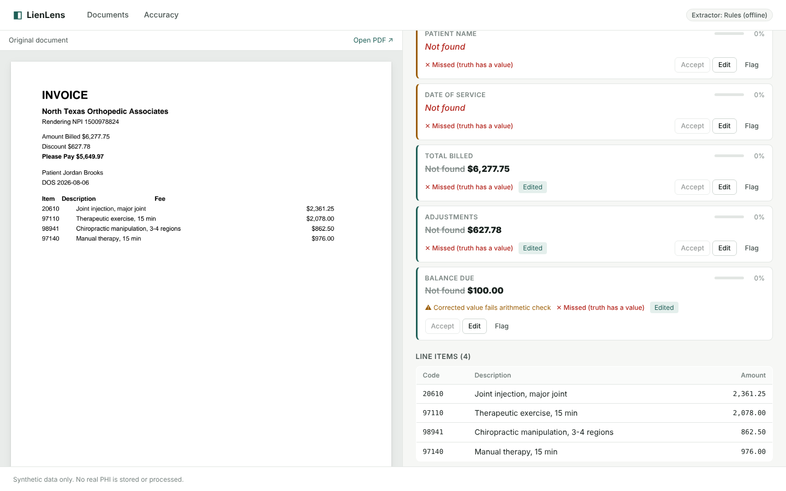
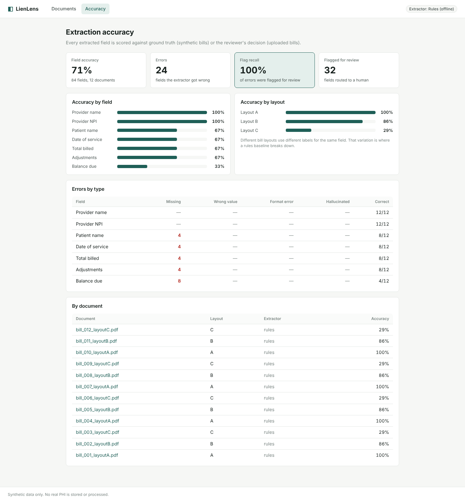

# LienLens

**LLM-powered document extraction for medical bills, with human-in-the-loop review and per-field accuracy scoring.**

LienLens turns unstructured medical bills into structured, reviewable data. A bill is uploaded, an extractor pulls the key billing fields, validation checks flag anything suspicious, and a reviewer confirms or corrects each field side by side with the original document. Every field is scored, so extraction quality is measured instead of assumed.

> **Data notice:** LienLens uses **synthetic medical bills only**. No real PHI is stored or processed. The design still follows PHI-safe practices (no document contents in logs, upload limits, a permission switch for authenticated-only access).



---

## Why

In personal injury settlements, medical bills and lien correspondence have to be reviewed to work out what is owed and to whom. Most of that work is manual: staff read inconsistent documents from many providers and re-key the same fields. LienLens explores how automated extraction plus targeted human review can speed this up **without** giving up accuracy. The key question it answers is: *which fields can a reviewer safely skip?*

## What it does

- **Upload** PDF bills (drag and drop), stored by Django and rendered as a page preview for review.
- **Extract** seven billing fields (provider, NPI, patient, date of service, total billed, adjustments, balance due) plus CPT/HCPCS line items.
  - **LLM extractor** (Anthropic API, forced tool use for schema-shaped JSON) when `ANTHROPIC_API_KEY` is set.
  - **Rules extractor** (label patterns + regex) otherwise, so the whole app runs offline. It doubles as the baseline the LLM is measured against.
- **Normalize** values into canonical forms (`$1,234.50` → `1234.50`, `June 11, 2026` → `2026-06-11`).
- **Validate** every extraction, because well-formed output can still be wrong:
  - format checks: dates parse, amounts parse, **NPI passes its Luhn checksum**
  - line items: valid CPT/HCPCS code pattern, numeric amounts
  - cross-field arithmetic: **line items sum to the total; total − adjustments = balance due**
- **Route to review**: missing, invalid, arithmetic-failing, or low-confidence fields are flagged. Reviewers can accept all unflagged fields in one click and focus on the flagged ones.
- **Review**: accept, edit, or flag each field. Corrections are re-validated too: a reviewer's typo that breaks the bill's arithmetic is flagged instead of silently saved.
- **Score** every field against ground truth (synthetic bills) or the reviewer's decision (uploaded bills), with error types: *missing, wrong value, format error, hallucinated*.
- **Measure flag recall**: of the fields the extractor got wrong, what share did validation catch? This is the number that tells you whether skipping unflagged fields is safe.

## Results (rules baseline, 12 synthetic bills)

| Layout | What's different | Field accuracy |
|---|---|---|
| A | standard labels (`Total Charges`, `Balance Due`) | 100% |
| B | hospital labels (`Amount You Owe`), long-form dates | 86% |
| C | terse invoice labels (`Please Pay`, `DOS`), no colons | 29% |
| **All** | | **71%**, with **100% flag recall** |

The rules extractor collapses on unfamiliar layouts, but every miss is flagged for review, so nothing wrong slips through unseen. Closing the accuracy gap on layouts like C is exactly what the LLM extractor is for; set an API key, run `seed_demo --reset`, and compare.



## Architecture

```
React + TypeScript (Vite)
        │  REST (JSON)
        ▼
Django REST Framework ──► SQLite / PostgreSQL
        │                 Document · ExtractionRun · ExtractedField · Review
        ▼
enqueue_extraction(document)
        │   (inline in this demo; the seam where SQS + a worker plug in)
        ▼
process_document: PDF text (pdfplumber) → extractor (LLM | rules)
                  → normalize → validate → persist fields + flags
```

| Layer | Technology |
|---|---|
| Frontend | React 19, TypeScript, React Router, Vite |
| API | Python, Django, Django REST Framework |
| Database | SQLite by default, PostgreSQL via env vars |
| Extraction | pdfplumber text; Anthropic API with tool-use schema, or rule-based fallback |
| Preview | pypdfium2 renders pages to PNG for the review screen |
| Test data | reportlab-generated synthetic bills in 3 layouts, with ground truth |
| CI | GitHub Actions: Django tests, ESLint, TypeScript build |

### API

| Method | Endpoint | Purpose |
|---|---|---|
| `GET` | `/api/documents/` | list documents with status, fields to review, accuracy |
| `POST` | `/api/documents/` | upload a PDF (multipart), runs extraction |
| `GET` | `/api/documents/{id}/` | document with extraction run, fields, validation issues |
| `DELETE` | `/api/documents/{id}/` | remove a document |
| `GET` | `/api/documents/{id}/file/` | original PDF |
| `GET` | `/api/documents/{id}/preview/` | page rendered as PNG |
| `POST` | `/api/documents/{id}/reextract/` | run extraction again (e.g. after a prompt change) |
| `POST` | `/api/fields/{id}/review/` | `{"decision": "accept" \| "edit" \| "flag", "corrected_value": "..."}` |
| `GET` | `/api/metrics/` | accuracy by field, layout, document; error types; flag recall |
| `GET` | `/api/health/` | status and active extractor |

### Data model

- `Document`: file, status (`queued → processing → needs_review → reviewed` / `failed`), optional ground truth
- `ExtractionRun`: extractor, model, prompt version, latency, line items, validation issues
- `ExtractedField`: value, confidence, validity, needs-review flag, review state, final value
- `Review`: decision, corrected value, reviewer, timestamp (an audit trail of every decision)

## Run it locally

Requirements: Python 3.12+, Node 20+.

```bash
# 1. Backend
cd backend
python -m venv .venv && source .venv/bin/activate
pip install -r requirements.txt
python manage.py migrate
python manage.py seed_demo --count 12      # synthetic bills, extracted and scored
python manage.py runserver                 # http://127.0.0.1:8000

# 2. Frontend (new terminal)
cd frontend
npm install
npm run dev                                # http://localhost:5173
```

Open http://localhost:5173. The Vite dev server proxies `/api` to Django.

**Use the LLM extractor:** `export ANTHROPIC_API_KEY=...` before `runserver` / `seed_demo`. Keys stay on the backend and are never sent to the browser.

**More test bills to upload by hand:** `python manage.py generate_bills --count 6 --out sample_bills`

**Tests:** `python manage.py test documents` (18 tests: normalization, NPI checksum, arithmetic checks, both extractors with the LLM client faked, upload validation, the review flow, correction re-validation, metrics).

## Design decisions

- **Validation is separate from extraction.** Both extractors produce the same shape and go through the same checks, so swapping models or prompts never weakens the safety net.
- **Forced tool use for the LLM.** The model must answer through a JSON schema, which removes free-text parsing failures. Its output is still validated, because a schema-valid answer can be wrong.
- **Scoring by error type, not just accuracy.** "Missing" and "hallucinated" need different fixes (prompting vs. grounding), so they're tracked separately.
- **Flag recall over raw accuracy.** In a human-in-the-loop system, the cost of an error depends on whether a person sees it. A 71%-accurate extractor with 100% flag recall is safer than a 95% one that hides its 5%.
- **One seam for async.** `enqueue_extraction` is the only call site; moving to SQS + a worker means changing that function, not the API or UI.

## Roadmap

- [x] Django REST API: documents, extraction runs, review endpoints
- [x] Rules extractor + LLM extractor (Anthropic tool use) behind one interface
- [x] Validation: formats, NPI checksum, CPT codes, cross-field arithmetic
- [x] React review UI with document preview and accept / edit / flag
- [x] Synthetic bill generator with ground truth (3 layouts)
- [x] Accuracy dashboard: per field, per layout, error types, flag recall
- [ ] Run the LLM extractor across the synthetic set and publish the comparison
- [ ] SQS-backed extraction worker and S3 document storage
- [ ] Authentication and role-based access (reviewer vs. admin)
- [ ] Highlight each extracted value's location on the document preview
- [ ] Lien correspondence extraction (letters from lienholders)
- [ ] docker-compose for one-command setup

## Author

**Asher Pranay Palle** · [github.com/Asherpranayp](https://github.com/Asherpranayp)
